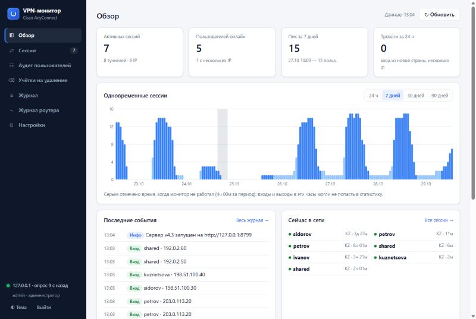
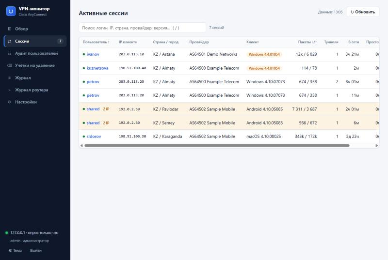
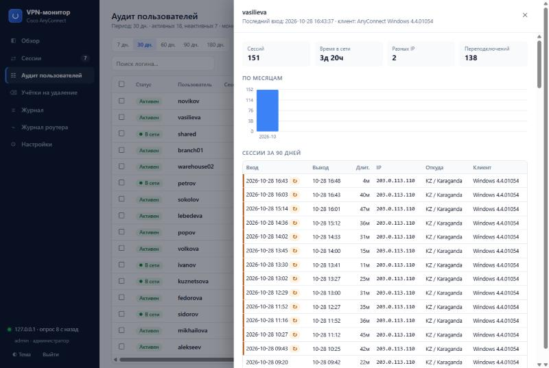
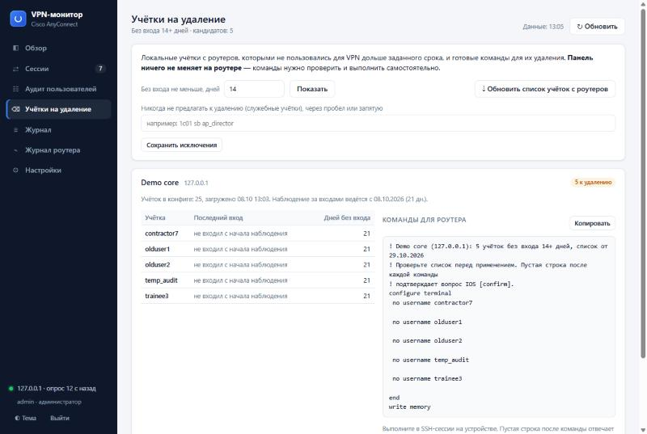
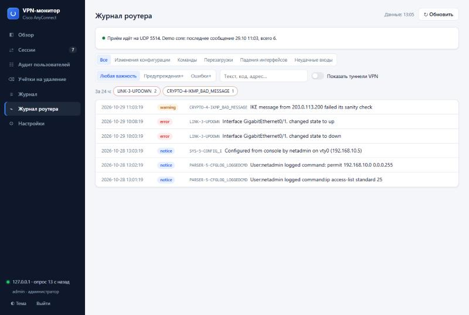

# Cisco AnyConnect Monitor

Веб-панель и фоновый сборщик статистики для **SSL VPN (WebVPN / AnyConnect) на маршрутизаторах Cisco IOS**: кто сейчас подключён, кто и сколько работал, кто давно не заходит, у кого устаревший клиент, что происходит на самом роутере. Работает на Windows: на рабочем ПК или как служба на Windows Server.

> **English summary.** A self-hosted web dashboard for SSL VPN (WebVPN/AnyConnect) on **Cisco IOS routers** (not ASA). It polls the router over SSH, stores every VPN session in SQLite and shows who is online, usage history per user, inactive and unused accounts, outdated AnyConnect clients, the router's own syslog, and sends Telegram alerts and weekly reports. Windows 10/11 or Windows Server 2016+. The UI is in Russian. MIT license.



## Зачем это нужно

На маршрутизаторах Cisco IOS с SSL VPN есть только `show webvpn session` — список подключённых прямо сейчас. Ни истории, ни отчётов, ни уведомлений. Из-за этого сложно ответить на простые вопросы:

- кто из сотрудников реально работает через VPN, сколько часов и с каких адресов;
- какие учётки VPN не использовались месяцами и их пора удалить;
- не заходит ли кто-то из другой страны или одновременно с двух адресов (передал пароль);
- у кого старый клиент AnyConnect;
- у кого постоянно рвётся соединение — это проблема канала, а не человека;
- когда перезагружался роутер и кто менял его конфигурацию.

Монитор опрашивает роутер по SSH каждые 30 секунд, сохраняет каждую сессию в базу и показывает всё это в браузере.

## Возможности

| | |
|---|---|
| **Активные сессии** | Живая таблица: логин, IP, страна и провайдер, версия AnyConnect и ОС, пакеты через туннель, время в сети и простоя. Подробности сессии с роутера и отключение сессии в один клик. |
| **Аудит пользователей** | Активные и неактивные за 7–180 дней, число сессий и дней, время работы, разные IP, последний вход. Фильтры: «в сети», «нестабильные» (частые переподключения), «устаревший клиент». Карточка пользователя с историей сессий. Экспорт в CSV для Excel. |
| **Учётки на удаление** | Локальные учётки из конфига роутера без входа в VPN N дней и готовые команды `no username …` для копирования. Администраторы (privilege 15) и учётка монитора исключаются автоматически. Сама панель на роутере ничего не меняет. |
| **Тревоги** | Вход из новой страны, один логин с нескольких IP, ночные входы, перезагрузка роутера, изменение конфигурации, падение интерфейса, серия неудачных входов, потеря связи с роутером. |
| **Telegram** | Тревоги, при желании каждый вход и выход, еженедельный отчёт: кто работал, кто не входил, пик нагрузки, тревоги, устаревшие клиенты. |
| **Журнал роутера** | Приём syslog с роутера: перезагрузки, изменения конфигурации (кто и какие команды — пароли в командах маскируются), падения интерфейсов. Шум (IP-телефоны, туннели VPN) отфильтрован. |
| **Несколько роутеров** | Любое число устройств в одной панели, у каждого свой поток опроса и SSH-соединение. |
| **Надёжность** | Работает как служба без входа пользователя, ежедневная резервная копия базы, учёт времени, когда сам монитор был выключен (такие часы отмечаются на графиках), `/api/health` для Zabbix и Uptime Kuma. |
| **Доступ** | Пароль на панель, пользователи с ролью «только просмотр», HTTPS с самоподписанным сертификатом, журнал действий администраторов. |

| Сессии | Аудит и карточка пользователя |
|---|---|
|  |  |
| **Учётки на удаление** | **Журнал роутера** |
|  |  |

## Что поддерживается

- **Оборудование:** маршрутизаторы Cisco IOS / IOS XE с SSL VPN (WebVPN), где работает `show webvpn session context all`. Проверено на Cisco 2951, IOS 15.7(3)M4b, с клиентами AnyConnect 4.x и Cisco Secure Client 5.x.
- **Не поддерживаются:** Cisco ASA и Firepower (FTD) — у них другие команды (`show vpn-sessiondb`).
- **Где запускать:** Windows 10/11 или Windows Server 2016+ (2019, 2022). Готовые EXE не требуют Python.
- **Требования к SSH:** роутер со старыми алгоритмами SSH (`diffie-hellman-group14-sha1`) поддерживается — для этого используется Paramiko 3.x.

## Быстрый старт

### 1. Подготовьте роутер

Монитору нужна учётная запись для SSH. Удобнее завести отдельную:

```
username vpnmonitor privilege 15 secret <пароль>
```

Монитор выполняет на роутере такие команды:

| Зачем | Команда |
|---|---|
| Список сессий | `show webvpn session context all` |
| Версия клиента, пакеты | `show webvpn session user <логин> context <контекст>` |
| Время работы роутера | `show version` |
| Список учёток для чистки | `show running-config \| include ^username` |
| Отключить сессию (только по кнопке администратора) | `webvpn session disconnect …` |

Проверено с учёткой privilege 15. С меньшим уровнем часть команд может быть недоступна: `show running-config` и отключение сессий точно требуют privilege 15. Если хотите ограничить права, дайте учётке нужные команды через `privilege exec level …` или AAA.

Если SSH на роутере разрешён только с определённых адресов (`access-class` на `line vty`), добавьте адрес компьютера с монитором.

### 2. Запустите монитор

**Вариант А — из исходников** (нужен Python 3.11+):

```bat
git clone https://github.com/bekzatv/cisco-anyconnect-monitor.git
cd cisco-anyconnect-monitor
python -m pip install -r requirements.txt
python server.py --open
```

**Вариант Б — собрать EXE** (ничего не нужно ставить на целевой машине):

```bat
Build-Exe.bat
Start-Server.bat
```

`Build-Exe.bat` ставит зависимости, прогоняет тесты и собирает:
- `dist\CiscoAnyConnectServer.exe` — сервер с веб-панелью;
- `dist\server-package\` — всё для установки на Windows Server;
- `dist\CiscoAnyConnectMonitor.exe` — старое настольное приложение (см. ниже).

### 3. Настройте в браузере

1. Откройте `http://127.0.0.1:8765/`. При первом входе задайте пароль панели — это можно сделать только с того же компьютера.
2. **Настройки → Устройства Cisco → Добавить устройство:** адрес роутера, SSH-логин и пароль. Кнопка «Проверить подключение» сразу покажет, работает ли доступ.
3. Через 30 секунд в разделе «Сессии» появятся подключения.

Чтобы монитор запускался при входе в Windows, выполните `Install-Autostart.bat` (отключение — `Remove-Autostart.bat`). Для работы круглосуточно лучше поставить его на сервер — см. ниже.

### Попробовать без роутера

В репозитории есть тестовый «роутер» (SSH-сервер, который отвечает как Cisco) и генератор демо-данных на три недели:

```bat
python tools\make_demo.py --data-dir demo
python tests\fake_router.py --port 2222
python server.py --data-dir demo --open
```

Логин `admin`, пароль `demo-password`. Все имена в демо вымышленные, все адреса из диапазонов для документации.

## Установка на Windows Server (круглосуточная работа)

На рабочем ПК монитор останавливается вместе с компьютером. На сервере он работает задачей Планировщика от имени SYSTEM: стартует при загрузке системы без входа пользователя, а каждые 5 минут задача проверяет, что он жив, и поднимает его после сбоя.

1. Соберите `dist\server-package\` (`Build-Exe.bat`) и скопируйте папку на сервер.
2. На сервере от имени администратора:

   ```bat
   Install-Server.bat
   ```

   Скрипт:
   - ставит программу в `C:\Program Files\CiscoAnyConnectMonitor`;
   - создаёт папку данных `C:\ProgramData\CiscoAnyConnectMonitor` с доступом только для SYSTEM и администраторов;
   - регистрирует задачу Планировщика;
   - открывает в брандмауэре TCP 8765 (панель) и UDP 514 (syslog, только из частных сетей);
   - включает доступ к панели из сети по HTTPS.

   | Параметр | Что делает |
   |---|---|
   | `-DryRun` | только показать шаги, ничего не меняя |
   | `-Port 8443` | другой порт панели |
   | `-LocalOnly` | панель только на самом сервере, без доступа из сети |
   | `-SyslogFrom 192.168.1.1` | откуда принимать syslog (по умолчанию частные сети) |
   | `-Bundle архив.zip` | загрузить данные, перенесённые с ПК |

3. Откройте `https://<сервер>:8765/`. Браузер предупредит о самоподписанном сертификате — это ожидаемо. Отпечаток сертификата для сверки показан в **Настройки → Доступ к панели**.

Обновление: скопируйте новый `server-package` и снова запустите `Install-Server.bat` — данные не затрагиваются. Удаление: `Uninstall-Server.ps1` (данные остаются, если не указан `-RemoveData`).

**Перенос с ПК на сервер.**
1. На ПК запустите `Export-ForServer.bat` — на рабочем столе появится `vpnmon-transfer-<дата>.zip`. В нём база, SSH-ключи роутеров и настройки **без паролей**: пароли зашифрованы Windows DPAPI для учётной записи на ПК и на другой машине не расшифруются.
2. Положите архив рядом с `Install-Server.bat` и запустите установку.
3. В панели введите заново пароли устройств и токен Telegram.

## Журнал роутера (syslog)

Чтобы роутер отправлял свой журнал монитору (старые `logging host` при этом остаются):

```
configure terminal
 logging host <IP монитора>
end
write memory
```

Чтобы видеть, **какие команды** вводили при изменении конфигурации:

```
archive
 log config
  logging enable
  notify syslog contenttype plaintext
```

Чтобы видеть неудачные входы на сам роутер: `login on-failure log`.

## Telegram

1. Создайте бота у [@BotFather](https://t.me/BotFather) и получите токен.
2. Напишите боту любое сообщение и узнайте свой chat ID: например, через [@userinfobot](https://t.me/userinfobot). Для группы добавьте бота в группу; ID группы начинается с `-`.
3. **Настройки → Telegram:** токен, chat ID, «Отправить тестовое сообщение».

Еженедельный отчёт по умолчанию уходит в понедельник в 9:00. Если сервер в это время был выключен, отчёт уйдёт при следующем запуске на той же неделе. В настройках есть «Предпросмотр» и «Отправить сейчас».

## Пользователи панели

- **Встроенный администратор:** логин `admin` (или пустой) и пароль, заданный при первом запуске.
- **Дополнительные пользователи:** **Настройки → Пользователи панели**, роли «Администратор» или «Только просмотр». Просмотр видит сессии, аудит, журналы и учётки, но не может отключать сессии, менять настройки, делать бэкап и перезапуск. Это проверяет сервер, а не только интерфейс.

Каждое действие администратора записывается в журнал с логином и IP.

## Безопасность

- **Пароли устройств и токен Telegram** хранятся зашифрованными через Windows DPAPI для учётной записи, под которой работает монитор.
- **Пароль панели** хранится как PBKDF2-SHA256 (310 000 итераций). После 5 неудачных попыток вход с адреса блокируется на 5 минут. Первый пароль задаётся только с самого компьютера.
- **SSH-ключ роутера** запоминается при первом подключении (`known_hosts`). Если ключ изменится, подключение блокируется — защита от подмены устройства.
- **Что панель делает на роутере:** выполняет только команды `show`. Исключение — отключение сессии по явной кнопке администратора. Команды для удаления учёток панель только показывает.
- **Защита веб-интерфейса:** cookie сессии `HttpOnly` и `SameSite=Strict`, CSRF-заголовок на изменяющих запросах, Content-Security-Policy, запрет встраивания во фреймы.
- **Журнал роутера:** пароли, ключи и SNMP-community в записанных командах маскируются до сохранения.
- **Доступ из сети** включайте только с HTTPS. Пароль и данные по HTTP идут открытым текстом.
- **Геолокация:** для страны и провайдера внешние IP пользователей отправляются на [ipinfo.io](https://ipinfo.io) (без токена; результат кэшируется). Если это недопустимо, закройте серверу доступ в интернет — всё остальное продолжит работать.

## Настройки

Все параметры меняются в веб-панели и хранятся в `settings.json` в папке данных. Основные:

| Параметр | По умолчанию | Описание |
|---|---|---|
| Интервал опроса | 30 с | как часто запрашивать список сессий |
| Хранить историю | 180 дней | старше — удаляется |
| Резервных копий базы | 7 | ежедневные копии в `backups\` |
| Минимальная версия AnyConnect | 4.10 | ниже — «устаревший клиент» |
| Нестабильное соединение | 3 переподключения в день | переподключение — новая сессия не позже 10 минут после конца предыдущей |
| Учётки на удаление | 60 дней | без входа в VPN |
| Порт панели / HTTPS / доступ из сети | 8765 / выкл / только локально | применяются после перезапуска сервера |
| Порт syslog | UDP 514 | применяется после перезапуска |

## Мониторинг самого монитора

`GET /api/health` доступен без входа и не раскрывает логины и адреса. Он отвечает `200 {"status": "ok"}`, когда все устройства опрашиваются, и `503`, когда нет. Подходит для Zabbix, Uptime Kuma или PRTG.

## Файлы

| Путь | Что это |
|---|---|
| `server.py`, `vpnmon/` | сборщик, база, веб-сервер; панель — `vpnmon/web/` |
| `server-install/` | установка, обновление и удаление на Windows Server |
| `tools/make_demo.py` | демо-данные для знакомства без роутера |
| `tests/` | тесты (`python -m unittest discover -s tests`) и тестовый SSH-«роутер» `fake_router.py` |
| `app.py` | первая версия — настольное приложение на Tkinter. Работает с той же базой, но развивается только веб-панель |

**Папка данных** — рядом с программой, а на сервере `C:\ProgramData\CiscoAnyConnectMonitor`:

| Файл | Что в нём |
|---|---|
| `connection_stats.db` | SQLite: сессии, журнал, учётки |
| `settings.json` | настройки |
| `known_hosts` | SSH-ключи устройств |
| `backups\`, `tls\`, `server.log` | резервные копии, сертификат панели, технический журнал |

**Эти файлы содержат данные вашей сети — не выкладывайте их.** Они уже перечислены в `.gitignore`.

## Ограничения

- IOS отдаёт трафик сессии только в **пакетах** (Rx/Tx IP Packets), не в байтах.
- Если у одного пользователя две сессии с одного IP, в таблице сессий у обеих показываются данные клиента одной из них.
- «Не входил ни разу» означает «не входил с начала наблюдения». Поэтому учётки без единого входа появляются в списке на удаление не раньше, чем через N дней после первого запуска монитора.
- Сессии, которые начались и закончились, пока монитор был выключен, восстановить нельзя. Такие периоды видны на графиках и в отчётах.
- Интерфейс на русском языке.

## Разработка

```bat
python -m pip install -r requirements.txt
python -m unittest discover -s tests
```

Тестовый роутер `tests\fake_router.py` поддерживает список сессий, подробности сессии в формате IOS 15.7, `show version`, `show running-config | include ^username` и отключение сессии. Второй профиль — `--profile branch` — нужен для проверки нескольких устройств.

## Лицензия

[MIT](LICENSE)
